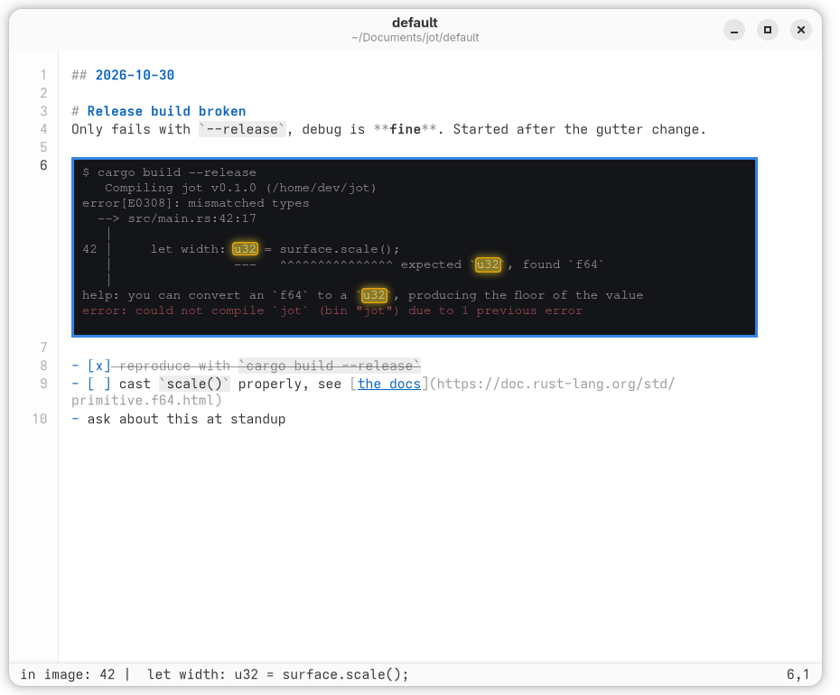

# jot

A fast, local scratchpad for programmers: one plain-text page, vim keys, and screenshots you can paste in and search.



While you work, you collect things: an error, a command that worked, a screenshot of something you'll need in ten minutes. Word processors fight you over fonts and formatting, and note apps want you to organize everything first.

jot is just a page. Open it, paste, type, move on. It's for the messy notes you take on the way to understanding something, not for finished documents.

Before you try it:

- **jot uses vim keys, and there's no other editing mode.** If you don't know vim, it isn't for you yet.
- **It runs on Linux** (GTK4). Your notes stay on your machine: there's no account, no sync and no network access.

## Install

jot is built from source. You'll need a C compiler, `make`, `pkg-config`, GTK 4.12+ and libadwaita 1.6+.

| Distro | Packages |
|---|---|
| Arch | `base-devel gtk4 libadwaita` |
| Fedora | `gcc make pkgconf-pkg-config gtk4-devel libadwaita-devel` |
| Debian, Ubuntu | `build-essential pkg-config libgtk-4-dev libadwaita-1-dev` |

Some older distro releases ship a libadwaita that's too old, so check the version if the build fails.

To read text in screenshots, also install Tesseract and its English data. It's optional, and everything else works without it.

| Distro | Packages |
|---|---|
| Arch | `tesseract tesseract-data-eng` |
| Fedora | `tesseract tesseract-langpack-eng` |
| Debian, Ubuntu | `tesseract-ocr` |

Then build and install:

```sh
git clone https://github.com/osigurdson/jot.git
cd jot
make
make install   # puts jot in ~/.local/bin and adds it to your app launcher
```

Make sure `~/.local/bin` is on your `PATH`. To install somewhere else, use `make install PREFIX=/your/path`.

## Using jot

Run `jot`. It opens your page in normal mode, with the cursor at the end.

1. **Write a note:** press `o`, type, then press `Esc`.
2. **Add a screenshot:** copy one to the clipboard, then press `p`. It lands on its own line below the cursor.
3. **Find something:** press `/` and type. This also finds text inside your screenshots.
4. **Leave:** type `:q`. There's nothing to save, because jot saves as you type.

Click an image, or move the cursor onto it, to select it. Then `gx` opens it, `yy` copies it, and `dd` deletes it.

### Pages

Each page is a folder, so you can keep separate ones for separate work:

```sh
jot               # your default page, ~/Documents/jot/default
jot work          # another page, ~/Documents/jot/work
jot ./scratch     # a page in any folder, such as inside a repo
```

Each page gets its own window. Set `$JOT_DIR` to use a different default page.

## Features

- **Screenshots in the text.** Paste them or drag them in. They show at their real size and shrink to fit the window.
- **Search inside images.** With Tesseract installed, jot reads each screenshot once, on your machine, and highlights matches in the picture. Right-click an image to copy its text. The status bar shows `indexing image…` while a read is running.
- **Always plain text.** Everything is in your monospace font at one size, and pasted text never brings formatting with it.
- **Light Markdown styling.** Headings, code, lists and links get color and weight, but every character stays visible and editable. Pasted code stays plain. `:set nomd` turns it off.
- **Small and native.** It's a compact C program that uses your system's GTK.

## Your notes are just files

```
~/Documents/jot/default/
├── jot.md                 your notes, as plain text
├── assets/
│   ├── 20261030-142211-a1b2c3.png       a screenshot
│   ├── 20261030-142211-a1b2c3.png.txt   its text, read by OCR
│   └── 20261030-142211-a1b2c3.png.tsv   word positions, for highlighting
├── AGENTS.md              a guide for coding agents
└── CLAUDE.md              a link to AGENTS.md
```

You can grep the folder, edit `jot.md` in another editor, or keep it in git. If you edit it elsewhere, jot reloads it when you switch back, as long as jot has no unsaved typing. `:Ex` opens the folder in your file manager.

## Using it with coding agents

Because a page is plain files, a coding agent can read it directly. That's useful when you've been deep in a problem and want help making sense of your notes:

```sh
cd ~/Documents/jot/default
claude
```

Then ask something like "what was I working on?" or "explain the error in my last screenshot". Each new page includes an `AGENTS.md` that explains the layout to the agent and tells it to leave your notes alone unless you ask it to change them. Claude Code reads it through `CLAUDE.md`, and other agents that support `AGENTS.md` can read it directly.

## How it differs from vim

Most of what you'd expect works: motions, counts, operators, text objects, visual mode, `/` search, `:s` and more. See the **[key reference](docs/keys.md)** for the full list. The main differences:

- `y`, `d` and `p` always use the system clipboard, like `clipboard=unnamedplus`.
- `Ctrl+V` pastes instead of starting block visual mode, which jot doesn't have.
- `.` repeat, macros, marks and named registers aren't implemented yet.
- `:s` patterns are close to vim's, but they're translated to PCRE, so unusual ones may behave differently.
- There's no config file or plugins.

## Development

```sh
make check   # headless UI tests (needs gtk4-broadwayd, included with GTK4 on most distros)
```

The code is split into `jot.c` (the app), `vim.c` (the editor keys) and `md.c` (Markdown styling).

## License

MIT. See [LICENSE](LICENSE).
